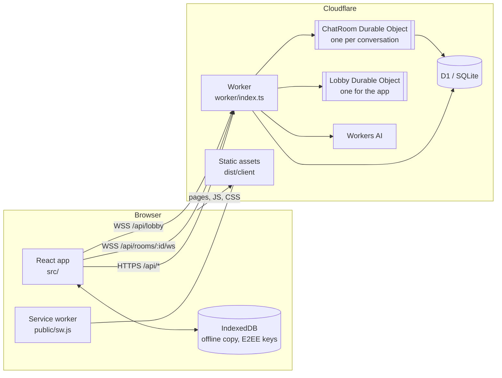
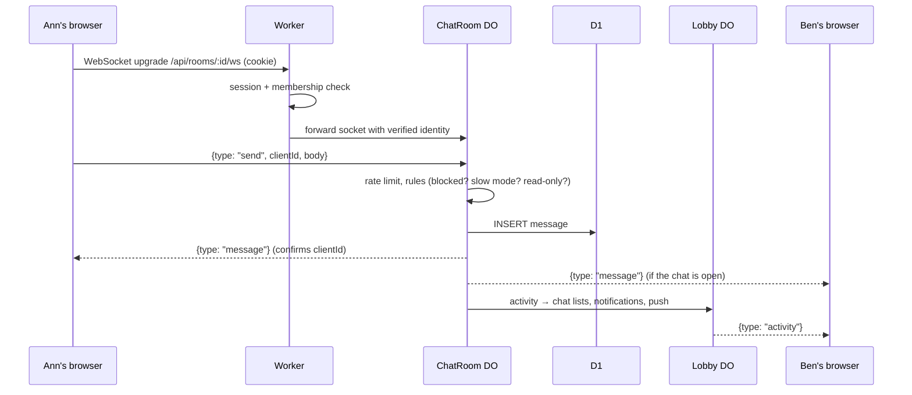
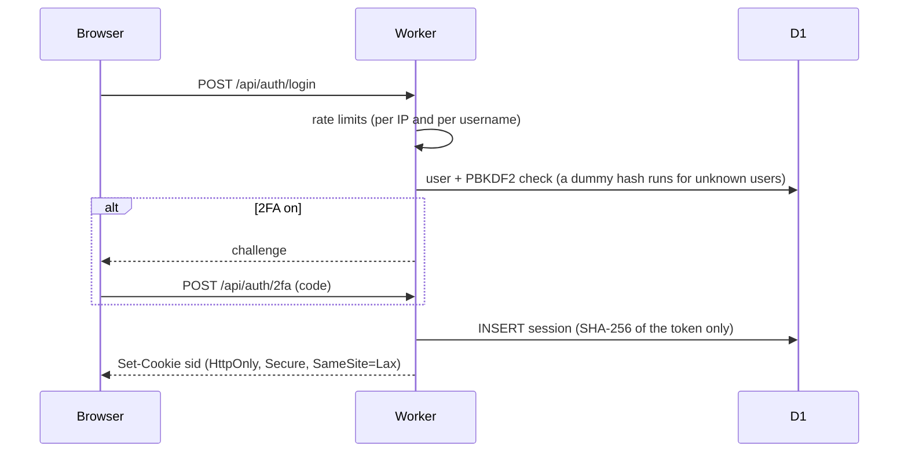

# Architecture

## Overview



- **One Worker** serves the app's files and the API. Requests that aren't `/api/*` are static assets (`run_worker_first` in `wrangler.jsonc`).
- **ChatRoom Durable Object** (`worker/room.ts`): one instance per conversation, so everyone in a chat shares one place where messages are ordered and broadcast. It also keeps that chat's media in its own SQLite storage.
- **Lobby Durable Object** (`worker/lobby.ts`): presence, chat-list updates, call signaling, broadcasts.
- Both use the **WebSocket Hibernation API**, so idle connections cost nothing.
- **The Worker checks identity and room membership before forwarding** anything to a Durable Object, which trusts only the identity the Worker passes in.

## Folder structure

```
shared/     Types and rules used by both sides (types, games, chat themes, legal/age rules, password rules)
worker/     Server: one file per area (auth, rooms, messages, media, features, admin, owner, moderation…)
src/        React app
  components/   Screens and UI pieces (games/ and chill/ are sub-areas)
  lib/          Non-UI logic: API client, calls engine, E2EE, offline store, theme, music player
migrations/ D1 schema, numbered and applied in order
public/     Files served as-is: service worker, icons, legal pages, headers
scripts/    Small Node tools (icons, VAPID keys, legal pages)
tests/      Playwright end-to-end tests
docs/       This documentation
```

Layered by side (shared / server / client) rather than by feature, because the rules in `shared/` must be identical on both sides (the server enforces, the app gives instant feedback).

## Sending a message



## Signing in



## Decisions (short ADRs)

See [`adr/`](adr/).
