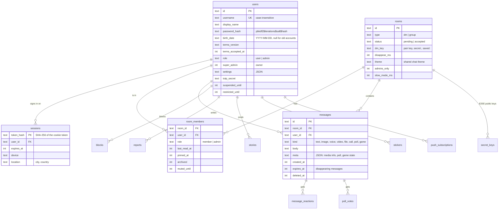

# Database

Relay uses **Cloudflare D1** (SQLite). The schema lives in [`migrations/`](../migrations), applied in number order. Each chat's media (photos, videos, voice notes, files) is stored separately, in that chat's Durable Object SQLite storage (`media`, `media_chunks`, `scheduled` tables in `worker/room.ts`).

## Main tables



Other tables: `admin_audit`, `site_settings`, `rate_limits`, `login_challenges`, `link_previews`, `starred`, `media_views`, `avatars`, `room_avatars`, `group_bans`, `story_views`, `transcripts`, `translations`, `chill_cache`. Each migration file starts with a comment explaining its tables.

## Migrations

```bash
# Create a new one: next number, short name
#   migrations/0017_something.sql
npm run db:migrate:local    # apply to the local database (tests do this automatically)
npm run db:migrate:remote   # apply to production: do this BEFORE deploying code that needs it
```

Rules: never edit a migration that has run in production; add a new one. Prefer `ALTER TABLE … ADD COLUMN` with a safe default, so old code keeps working until the new code is deployed.

## Housekeeping (cron, every 15 minutes)

`scheduled()` in `worker/index.ts`: deletes expired disappearing messages, lifts finished suspensions, removes stories after 24 h, trims the Chill cache, and purges old rate-limit counters, expired sessions and expired sign-in challenges.
